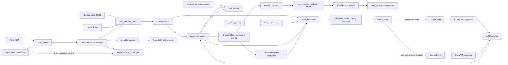

# Diseño de arquitectura

## Referencias de consistencia: unidad 8.1

`harness/reference_cases.py` carga un contrato local de casos, lo vincula al `InterviewSetup` validado y resuelve claves/índices contra el perfil y `build_temporal_facts`. La huella del candidato fija la fuente revisada; los resultados se entregan como copias. No depende de un cliente LLM ni del controlador de conversación.

`scripts/show_reference_cases.py` presenta preguntas, valores resueltos y notas humanas. El esquema no admite respuestas generadas o puntuaciones. Una sesión nueva por caso es un requisito declarado para el ejecutor futuro, todavía no implementado. Las 40 comprobaciones nuevas verifican preparación y conservación, no consistencia semántica del modelo. Véase la [unidad 8.1](../pruebas/referencias-consistencia.md).

## Diagrama de componentes

Flujo de datos actualmente implementado:

## Responsabilidad de agent y harness

`agent/agent.md` define las instrucciones, versión 1.0.11, y se incorpora al contexto autorizado. `config/interviews/basica.json` define la primera configuración con su esquema. `harness/` contiene datos, presentación, preparación de mensajes y comunicación con el modelo local:

| Componente | Responsabilidad implementada |
| --- | --- |
| `harness/json_loader.py` | Leer JSON local en UTF-8, detectar errores y devolver datos independientes; permite conservar los bytes de la misma lectura. |
| `harness/schema_validator.py` | Aplicar un esquema JSON Schema 2020-12 a datos ya cargados y comunicar el primer error estructural. |
| `harness/profile.py` | Validar y proteger el perfil, comprobar integridad y seleccionar los campos públicos del CV. |
| `harness/application/cli.py` | Presentar CV y puesto, comandos, preguntas, respuestas y errores. |
| `harness/runtime.py` | Coordinar intentos, límite e integridad, sin entrada o salida de consola. |
| `harness/session_state.py` | Identidad, configuración, fechas, registro técnico y copias de la sesión; sin I/O. |
| `harness/session_log.py` | Validar registros cerrados, guardarlos sin sobrescribir y leer sus datos para revisión. |
| `scripts/run_interview.py` | Cargar una vez, crear el cliente seleccionado, ejecutar la consola y cerrar recursos. |
| `harness/interview_config.py` | Validar configuración, candidato y puesto, comprobar referencias y conservar copias independientes. |
| `harness/prompt_builder.py` | Cargar instrucciones confiables y construir el contexto inicial separando instrucciones y pregunta. |
| `harness/llm/messages.py` | Documentar y validar el contrato serializable de roles y contenido, sin dependencia del proveedor. |
| `harness/llm/client.py` | Definir la interfaz `generate`, respuesta inmutable y errores compartidos. |
| `harness/llm/config.py` | Conservar parámetros explícitos de ambos proveedores, sin claves en sus objetos. |
| `harness/llm/ollama_client.py` | Enviar mensajes a Ollama con HTTPX y validar la respuesta. |
| `harness/llm/openai_client.py` | Adaptador opcional de Responses; verificado con transporte simulado. |
| `harness/llm/factory.py` | Crear el cliente seleccionado, con Ollama predeterminado y bloqueo explícito del uso externo. |

El lector compartido se añadió como utilidad de apoyo a la arquitectura aprobada, para evitar duplicar la lectura en los futuros módulos de perfil y configuración del puesto. La separación de responsabilidades se mantiene: el lector no aplica esquemas y el validador no accede a archivos. El lector utiliza únicamente la biblioteca estándar de Python.

## Interfaces y contratos

`load_json(path)` devuelve el valor JSON interpretado, o lanza `JsonLoadError` con la ruta del archivo. `validate_data(data, schema)` devuelve `None` o lanza `DataValidationError` para datos incorrectos e `InvalidSchemaError` para reglas mal definidas.

El flujo comprobado es: archivo de datos y archivo de esquema → lectura de cada uno con `load_json` → aplicación de `validate_data`. Las dos pruebas de integración usan el candidato y el puesto aprobados y comprueban la conservación de sus archivos originales.

Para el candidato, `validate_profile_data(profile, schema)` integra la comprobación estructural y la coherencia interna, sin acceder a archivos. La tercera prueba de integración lo aplica al perfil aprobado después de leerlo y verifica que el perfil y el esquema permanezcan intactos.

`load_json_with_bytes(path)` añade una operación compartida: devuelve datos y bytes exactos de una misma lectura. `load_json(path)` conserva su contrato anterior y delega en ella. Este ajuste evita calcular la huella sobre una lectura distinta de los datos que se validaron.

`load_profile(path, schema_path=...)` integra lectura, validación y creación de `CandidateProfile`. Su contenido se conserva como una cadena JSON inmutable; `to_dict()` devuelve copias internas independientes. La ruta absoluta y la huella SHA-256 permiten comprobar el archivo con `assert_source_unchanged()`. La cuarta prueba de integración verifica esa carga protegida sobre el candidato aprobado.

`to_public_resume()` devuelve una selección explícita de campos profesionales y `format_resume(profile)` utiliza únicamente esa vista para construir el texto. La selección pertenece al módulo de datos; las secciones y fechas legibles pertenecen a la presentación. La quinta prueba de integración comprueba el recorrido completo sin cambiar el archivo aprobado. No hay un JSON de CV mantenido por separado. La consola permite consultarlo antes o durante la ejecución.

`load_interview_setup(config_path=..., candidate_path=..., job_path=...)` valida cada documento y comprueba configuración→candidato, configuración→puesto y candidato→puesto. Devuelve `InterviewSetup` con el candidato protegido y copias de acceso de configuración y puesto. No busca documentos por identificador ni crea una sesión. La sexta prueba de integración conserva los tres archivos aprobados.

`load_instructions(path=...)` obtiene el texto confiable. `build_messages(setup, question, instructions=..., history=...)` lo recibe explícitamente y construye un mensaje `system` con reglas y datos JSON, los pares anteriores `user/assistant` y un mensaje `user` con la pregunta actual intacta. Se incluyen el perfil interno, el puesto, la configuración del escenario y `literal_name_references`, índice derivado de las denominaciones exactas de esos datos. No se serializan el objeto `InterviewSetup` completo, las rutas de archivos, las huellas o el entorno del proceso. La séptima integración comprueba este recorrido con los cuatro archivos reales.

El índice queda al final del objeto de contexto. Sus claves son rutas a campos del JSON ya incluido, como `/candidate_profile/education/0/institution`, y sus valores son copias literales de esos campos. Abarca nombre del candidato, instituciones y títulos de formación, organizaciones y cargos laborales, proyectos y denominaciones de la oferta. Distingue antecedentes del candidato y datos del puesto. No consulta la pregunta para seleccionar nombres, no mantiene otro archivo de perfil y no corrige la respuesta del modelo. Es una ayuda de contexto cuyo efecto requiere comprobación real.

## Separación candidato, clasificador y evaluador

La fase actual desarrolla únicamente el candidato virtual. Los archivos reservados de clasificación, puntuación y retroalimentación educativa siguen sin implementación y no participan en el flujo comprobado.

Las instrucciones distinguen los hechos del perfil, las exigencias del puesto, la configuración autorizada y las preguntas del entrevistador. El puesto no atribuye experiencia al candidato. El historial aporta continuidad, pero no convierte una respuesta errónea en un antecedente válido. La selección inicial del CV no impide que el candidato use situaciones internas pertinentes cuando se le pregunte por ellas.

`agent/agent.md` no duplica nombres, fechas o empresas del primer candidato. `harness/prompt_builder.py` ya lo incorpora junto a los datos como contexto de sistema, conservando la pregunta en otro rol. Esto no demuestra que el modelo siga las reglas ni sustituye las pruebas reales. El contexto interno para el modelo no se utiliza como CV ni se muestra íntegro al entrevistador.

## Estado, contexto y registros

La instantánea del perfil no guarda estado de entrevista ni modifica antecedentes. Configuración y puesto también se conservan como instantáneas con copias de acceso. `InterviewRuntime` coordina un `SessionState` que conserva identidad, configuración, cierre e intentos. El contador se obtiene de los intentos y los turnos completos se derivan de los aceptados. `history_messages()` devuelve una copia independiente de esos mensajes. El registro incluye identificadores y fechas UTC; se archiva en JSON al cerrar. Los resúmenes siguen pendientes.

El punto de ejecución carga las instrucciones una vez y las pasa al controlador, que conserva ese texto. La construcción de mensajes es independiente en cada llamada y no lee archivos. Cada pregunta recibe perfil, puesto, configuración y pares anteriores completos de la misma entrevista. El controlador comprueba el original antes y después de generar; el punto de ejecución vuelve a comprobarlo al cerrar. La gestión del tamaño y los resúmenes quedan para otras unidades de la Etapa 7; esta unidad conserva todos los pares completos sin recortarlos.

El archivo de configuración refiere al candidato y puesto sin copiar antecedentes ni competencias. Su esquema admite modalidades, enfoques y estilos, con `max_questions` entero de 1 a 20. `config_id` identifica una configuración reutilizable, no una sesión. El archivo no configura un proveedor ni contiene rúbrica. El cargador valida las referencias y prepara el escenario; la consola inicia el envío de preguntas con `/iniciar`.

## Controles de consistencia y errores

La lectura detecta errores de archivos y JSON. Se validan los tres esquemas. El perfil añade coherencia de fechas, jornadas e identificadores internos; el cargador comprueba los vínculos entre documentos y la huella del candidato antes de devolver el escenario. Los periodos mensuales son inclusivos. El significado de los relatos y el cumplimiento de requisitos del puesto no se evalúan automáticamente.

La carga protegida comprueba la huella, sin bloquear ediciones externas ni restaurar archivos. El CV excluye campos internos. El constructor conserva los roles ante texto de preguntas que simula instrucciones, pero no garantiza la resistencia semántica del modelo. El controlador cuenta preguntas enviadas, incluidos errores del proveedor, e impide superar el límite o reutilizar una ejecución cerrada. Los comandos y entradas vacías no consultan el modelo. Una respuesta cortada no se presenta como respuesta válida. Hay conversación con memoria por ejecución y guardado/lectura JSON local. La evidencia de las 690 pruebas está en [tests/integration/README.md](../../tests/integration/README.md).

El adaptador Ollama valida mensajes antes de enviarlos. Usa solo una dirección de este equipo, sin proxies del entorno, redirecciones, credenciales o cambio automático de proveedor. Reintenta una vez los fallos al conectar; no repite una generación tras un tiempo de espera de lectura. Distingue conexión, tiempo de espera, modelo ausente, fallo HTTP y respuesta inválida. Los límites de espera corresponden a operaciones de red, no a un plazo absoluto de toda la ejecución.

El resultado común añade campos opcionales de tiempo del servidor, carga, procesamiento del contexto, generación y tokens reutilizados. Ollama convierte sus duraciones de nanosegundos a segundos; valores ausentes o inválidos quedan desconocidos. Los demás proveedores no reciben métricas inventadas. El adaptador local envía `keep_alive: 15m` para solicitar permanencia entre consultas. Esta residencia no es historial de entrevista ni sustituye la gestión de contexto pendiente. El diagnóstico y sus límites están en la [guía de rendimiento](../rendimiento-local.md).

El modelo predeterminado es `gemma3n:e2b`, elegido entre los instalados después de comprobar que los pesos de `qwen3:4b` pertenecen a Thinking-2507 y solo admiten razonamiento. Se retiraron los ajustes experimentales de plantilla. El cliente adapta únicamente el par inicial para Gemma 3n; Gemma 4 conserva los roles originales. No cambia de modelo al fallar. Rechaza marcas de razonamiento en `content`; el script rechaza como prueba incompleta las salidas que alcanzan el límite de tokens. Esos controles no identifican todo posible razonamiento sin marcas ni validan la veracidad del texto. El detalle y la fuente están en la guía de conexión.

`scripts/smoke_test.py` usa la fábrica, prepara el escenario, hace una llamada y comprueba la huella incluso ante errores conocidos. Guarda evidencia técnica en `outputs/results/`, sin copiar el contexto interno, claves o el campo de razonamiento. No implementa sesiones o historial. Véanse la [guía local](../conexion-ollama.md) y la [alternativa externa opcional](../conexion-api-opcional.md).

La fábrica lee variables de la sesión, sin cargar archivos `.env`. Para la ruta externa exige `LLM_PROVIDER=openai`, `LLM_ALLOW_EXTERNAL_API=true`, modelo y clave; la ruta local no consulta esos dos últimos valores. No cambia de proveedor tras errores. El adaptador externo usa el endpoint oficial fijo con HTTPS, sin redirecciones ni proxies del entorno. La clave está fuera de `OpenAISettings` y solo se aplica a la cabecera de autorización. El flujo de configuración incompleta y el contrato HTTP se comprobaron con simulaciones, sin credenciales reales o validación de facturación y disponibilidad externa.

## Puntos de extensión para interfaz futura

La consola obtiene entradas y presenta datos; `InterviewRuntime.ask(question)` solo necesita escenario, instrucciones y el contrato del cliente. Otra interfaz puede utilizar ese controlador sin incorporar comandos de terminal a la lógica del candidato. El controlador y sus archivos de sesión están separados de la interfaz; la gestión del tamaño del contexto sigue pendiente. Véase [la guía de consola](../consola.md).

## Ajuste tras las incidencias de consola

El contexto incluye un índice de hechos por proyecto, derivado de sus identificadores y situaciones con vínculo explícito. Las instrucciones quedan separadas del JSON por marcadores. El contrato del constructor sigue siendo system/user; la adaptación inicial a un único turno user pertenece exclusivamente al transporte de Gemma 3n. Gemma 4 conserva sus roles nativos. La fábrica permite elegir un modelo local mediante OLLAMA_MODEL, sin sustituirlo al fallar ni habilitar una API. Estos cambios no añaden historial, filtros de preguntas, evaluación o garantía semántica. Véase el [registro de corrección](../pruebas/correccion-conducta.md).

## Referencia cronológica derivada

`project_chronology` contiene los proyectos ordenados por inicio y por término, y las intersecciones mensuales de sus periodos. Se calcula a partir de las fechas validadas de la instantánea, sin consultar la pregunta o sustituir los datos aprobados. Después de las instrucciones se añade una vista legible de esos mismos hechos con un marcador propio. El historial sigue conservando su rol de conversación. Esta ayuda se incorporó tras una respuesta con orden temporal incorrecto; no verifica automáticamente las afirmaciones del LLM. Véase el [registro de corrección](../pruebas/correccion-cronologia.md).

## Cálculos temporales y estudios

`harness/temporal_facts.py` recibe el perfil ya validado y construye hechos derivados sin I/O ni proveedor. Cuenta la unión de meses de los roles laborales, conserva periodos y jornadas, no convierte datos insuficientes a jornada completa, y ordena términos de todos los proyectos, estudios y titulación. Los meses incluyen ambos extremos; una práctica sin jornada registrada conserva esa ausencia. El contexto incorpora el objeto temporal_facts y su referencia legible después de la referencia de proyectos. Así se mantiene visible la comparación conjunta al final del sistema. El historial y el archivo del perfil no se alteran. No se crea un clasificador de preguntas ni se sustituye la salida del modelo. Véase la [corrección de duración y estudios](../pruebas/correccion-duracion-y-estudios.md).

## Identidad y registro técnico de sesiones

`SessionState` conserva configuración, identificadores, fechas UTC e intentos. El contador deriva de la lista de intentos; los mensajes del contexto derivan solo de registros completados. `session_dict()` y `history_messages()` devuelven copias independientes. El estado técnico y el catálogo de incidencias no clasifican preguntas ni evalúan contenido. Los detalles arbitrarios de excepciones y cuerpos HTTP no se copian al registro. La integridad detectada como fallida queda registrada aunque posteriormente se restauren los bytes.

El programa pasa explícitamente proveedor y modelo al controlador sin ampliar `LLMClient.generate`. La interfaz muestra un resumen con `/sesion` y al finalizar. Los metadatos de sesión no se envían al modelo. Los registros permanecen en memoria durante la ejecución y se archivan al cerrar. Véanse la [unidad 7.2](../sesiones-en-memoria.md) y el [guardado y lectura de la 7.3](../persistencia-sesiones.md).

## Diagnóstico del contexto registrado

`harness/context_budget.py` compara tokens ya informados con capacidad, reserva de salida y margen explícitos. `scripts/inspect_context.py` usa `load_session` y muestra el informe sin red o escritura. No forma parte del envío al candidato ni altera el registro 1.0.0; no estima preguntas futuras ni reduce el historial. Los parámetros de comparación no se presentan como ajustes históricos del archivo. Véase la [unidad 7.4a](../diagnostico-contexto.md), con pruebas y límites.

## Rechazo explícito de contexto excesivo

El adaptador Ollama envía `truncate: false` y `shift: false` en el nivel principal de `/api/chat`. Para formas conocidas del rechazo genera `LLMContextLimitError`, sin copiar el cuerpo; otros errores conservan su tratamiento. El catálogo y el esquema de sesión admiten `context_limit`. La consola conserva el historial, cuenta el intento y permite acortar la pregunta o finalizar. No se cambia la capacidad ni se reenvía automáticamente. Se verificó con Ollama 0.34.2 y gemma4:e4b; resumen e integración de reducción siguen pendientes. Véase la [unidad 7.4b](../proteccion-contexto.md).

## Propuesta extractiva verificable

`harness/history_summary.py` recibe registros validados, conserva configuración y procedencia, separa turnos antiguos/recientes y pide solo índices de fragmentos antiguos mediante el contrato LLM existente. Python copia citas, conserva anclas aunque el modelo las omita y reconstruye la propuesta para validarla. `scripts/preview_summary.py` muestra el resultado para revisión; no escribe archivos ni cambia el controlador. Las reglas conservadoras no certifican relevancia o verdad de las citas. La activación y el presupuesto del resumen siguen pendientes; véase la [unidad 7.4c](../resumen-extractivo.md).

## Composición del contexto de prueba

`harness/summary_context.py` revalida la propuesta y vincula perfil, configuración, referencia del puesto e instrucciones al escenario actual. Conserva preguntas user y citas assistant, añade guía estática de referencias a ambas variantes y una guía adicional cuando hay extractos y mantiene completos los pares recientes. Compara ambas listas de mensajes serializadas y usa extractos solo si disminuyen sus bytes. Esa medición no garantiza ahorro de tokens o ajuste al contexto. `scripts/probe_summary_context.py` consulta al candidato de forma aislada sin reanudar o modificar el archivo fuente. La consola y el controlador actuales no cambian; véase la [unidad 7.4d](../contexto-con-resumen.md).

## Política de contexto en el controlador

`LiveContextPolicy` en `harness/live_context.py` decide la activación a partir de pares completos, entrada informada o un rechazo previo de contexto. `InterviewRuntime` prepara las fuentes antes de registrar el envío de la pregunta y controla la integridad alrededor del selector. Una selección fallida conocida conserva el contexto completo; una interrupción o fallo de integridad evita inventar un intento del candidato. Cada preparación tiene auditoría independiente; las selecciones no alteran el contador ni el registro íntegro.

La opción `--extractive-context` habilita esta ruta. El contrato de sesiones admite 1.0.0 y 1.1.0; la segunda requiere política y eventos, cuyos índices se verifican contra el prefijo del historial. Se registran medidas, huellas y tiempo de preparación, sin copiar el contexto interno o texto libre inválido. El lector comprueba secuencia, fuentes y coherencia de decisiones, no verdad semántica. Véase [resumen en entrevista](../resumen-en-entrevista.md).
